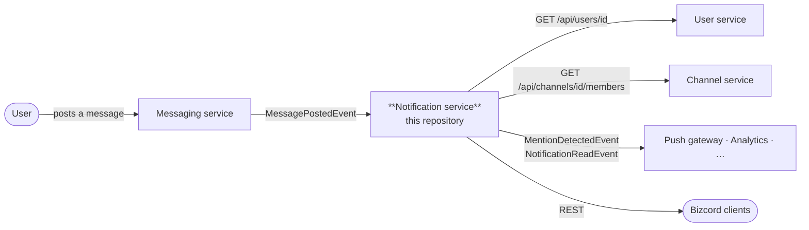

# Bizcord – Notification Service

System Integration (E2026) · semester project · **Bizcord**, a Discord-like enterprise
communication platform.

This repository contains one microservice from that platform: the service that decides **who
needs to know about what**, and keeps track of whether they have seen it. It consumes
`MessagePostedEvent` from the Messaging service, works out who was mentioned, applies each
user's notification preferences, stores the notification and publishes
`MentionDetectedEvent` for whoever delivers push notifications.



## Quick start

```bash
docker compose up -d --build
```

| | |
| --- | --- |
| Swagger UI | <http://localhost:8080/swagger> |
| Readiness probe | <http://localhost:8080/health/ready> |
| RabbitMQ management | <http://localhost:15672> (guest / guest) |
| WireMock stand-ins for the other teams' services | <http://localhost:8081/__admin> |

Ports can be overridden if they are taken:
`RABBITMQ_UI_PORT=15673 NOTIFICATION_SERVICE_PORT=8090 docker compose up -d`

Running without Docker:

```bash
dotnet run --project apps/notification-microservice/src/Bizcord.NotificationService.Presentation
```

### Try the feature

```bash
# create a notification by hand
curl -X POST http://localhost:8080/api/notifications \
  -H "Content-Type: application/json" \
  -d '{"recipientId":"11111111-1111-1111-1111-111111111111","type":"System","title":"Hi","body":"Welcome"}'

# the real path: publish a MessagePostedEvent that mentions someone and watch the
# notification appear
curl "http://localhost:8080/api/notifications?recipientId=11111111-1111-1111-1111-111111111111"
```

[06 – Deployment](docs/06-deployment.md#verified-behaviour) shows the full round trip,
including the exact event that produced *"Demo User mentioned you"*.

## Tests

```bash
dotnet test
```

| Project | Tests | Needs |
| --- | --- | --- |
| `…UnitTests` | 95 | nothing |
| `…ServiceTests` | 28 | nothing (the API runs in memory, WireMock stubs the rest) |
| `…IntegrationTests` | 4 | RabbitMQ (`docker compose up -d rabbitmq`); skipped if absent |

## Repository layout

```
├── apps/
│   └── notification-microservice/
│       ├── src/
│       │   ├── …Domain/           entities, value objects, rules (no dependencies)
│       │   ├── …Application/      use cases, the MessagePostedEvent handler, ports
│       │   ├── …Infrastructure/   repositories, HTTP clients, resilience
│       │   └── …Presentation/     REST API, validation, problem details, health
│       ├── tests/                 unit · service · integration · shared test support
│       ├── Dockerfile             multi-stage build
│       └── README.md
├── packages/
│   ├── Shared.Contracts/          the only thing other teams compile against
│   └── MessageClient/             IMessageClient / IMessageHandler over EasyNetQ
├── docker/wiremock/mappings/      stubs for the User and Channel services
├── docs/                          analysis, design and decisions
└── docker-compose.yml
```

## Design in one page

* **Bounded context.** We own notifications and notification preferences. We do not own
  messages, users or channel membership, and we store none of them —
  [data ownership](docs/01-analysis-and-design.md#4-data-ownership).
* **Communication.** Events (RabbitMQ) where temporal decoupling matters, REST where an
  answer is needed immediately —
  [why](docs/08-architecture-decisions.md#adr-3--events-for-messaging--notification-rest-for-lookups).
* **The broker is replaceable.** One class in the solution knows that RabbitMQ exists —
  [05 – Messaging](docs/05-messaging.md).
* **Failure is designed for.** Fail open when the User service is down, fail closed when the
  Channel service is down, keep serving HTTP when the broker is down —
  [failure modes](docs/01-analysis-and-design.md#6-what-happens-when-a-dependency-fails).
* **The business rules live in the domain.** `NotificationPreference.Decide` returns a
  decision *and a reason*, not a boolean buried in a handler.

Full documentation: **[docs/](docs/README.md)** — start with
[01 – Analysis & design](docs/01-analysis-and-design.md), or jump to
[09 – Assignment checklist](docs/09-assignment-checklist.md) to see where each required task
is solved.

## Tech

.NET 10 · ASP.NET Core · EasyNetQ 8 on RabbitMQ · xUnit v3 · Moq · FluentAssertions ·
WireMock.Net · Docker Compose · central package management
