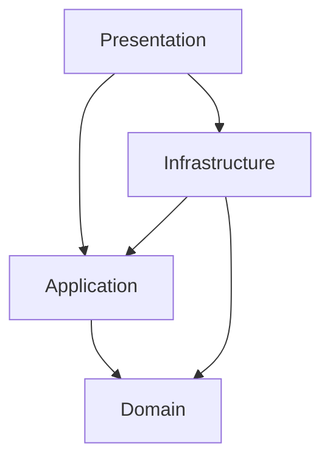

# Notification microservice

Owns **notifications** and **notification preferences** in Bizcord: who should be told about
what, and whether they have seen it.

## Responsibility

| Does | Does not |
| --- | --- |
| Detect mentions in posted messages | Store or edit messages (Messaging) |
| Decide whether a mention is worth interrupting someone for | Deliver push, e-mail or SMS (push gateway) |
| Store notifications and their read state | Own users or display names (Users) |
| Serve the inbox and the unread badge count | Own channel membership (Channels) |
| Manage mute, quiet hours and mention switches | Decide who is online (Presence) |

## Running it

```bash
# from the repository root
docker compose up -d --build                 # with RabbitMQ and WireMock stubs
dotnet run --project src/Bizcord.NotificationService.Presentation   # or just the service
```

Swagger: `/swagger` · liveness: `/health/live` · readiness: `/health/ready`

## Projects



| Project | Contains | References |
| --- | --- | --- |
| `…Domain` | `Notification`, `NotificationPreference`, value objects, `MentionParser`, repository ports | nothing |
| `…Application` | Use cases, `MessagePostedHandler`, downstream ports | Domain, Shared.Contracts, MessageClient |
| `…Infrastructure` | In-memory repositories, HTTP clients with retry/timeout/circuit breaker | Application, Domain |
| `…Presentation` | Controllers, request DTOs, problem details, health checks, DI composition | all of the above |

Dependencies point inwards: the domain knows nothing about HTTP, RabbitMQ or storage.

## Endpoints

| Method | Route |
| --- | --- |
| `POST` | `/api/notifications` |
| `GET` | `/api/notifications/{id}` |
| `GET` | `/api/notifications?recipientId=&channelId=&status=&skip=&take=` |
| `GET` | `/api/notifications/unread-count?recipientId=` |
| `PUT` | `/api/notifications/{id}` |
| `POST` | `/api/notifications/{id}/read` |
| `DELETE` | `/api/notifications/{id}` |
| `GET`/`PUT` | `/api/users/{userId}/notification-preferences` |

Details, examples and the status-code policy: [docs/04 – REST API](../../docs/04-rest-api.md).

## Messaging

| Direction | Event |
| --- | --- |
| consumes | `MessagePostedEvent` (owned by Messaging) |
| publishes | `MentionDetectedEvent`, `NotificationReadEvent` |

The subscription id — and therefore the queue name — is `notification-service`. Several
instances sharing it become competing consumers, so the service scales horizontally.

## Configuration

| Variable | Default |
| --- | --- |
| `RABBITMQ_HOST` / `RabbitMq__Host` | `localhost` |
| `RabbitMq__Port`, `RabbitMq__Username`, `RabbitMq__Password` | `5672`, `guest`, `guest` |
| `RabbitMq__SubscriptionId` | `notification-service` |
| `Services__UserDirectory__BaseUrl` | – |
| `Services__ChannelDirectory__BaseUrl` | – |
| `Services__*__Enabled` | `true` |
| `EnableSwagger` | `true` |

## Tests

```bash
dotnet test tests/Bizcord.NotificationService.UnitTests          # 95, no dependencies
dotnet test tests/Bizcord.NotificationService.ServiceTests       # 28, in-memory API + WireMock
dotnet test tests/Bizcord.NotificationService.IntegrationTests   # 4, needs RabbitMQ
```

Strategy, test doubles and the contract test: [docs/07 – Testing](../../docs/07-testing.md).

## Docker

`Dockerfile` is a multi-stage build whose **context is the repository root**, because the
service references `packages/Shared.Contracts` and `packages/MessageClient`:

```bash
docker build -f apps/notification-microservice/Dockerfile -t bizcord/notification-service .
```

See [docs/06 – Deployment](../../docs/06-deployment.md) for why each stage looks the way it
does.
