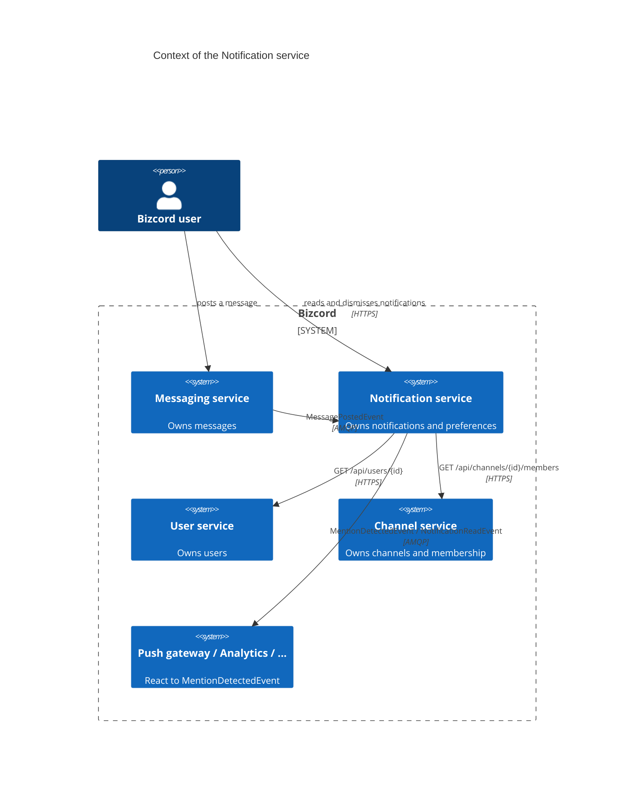
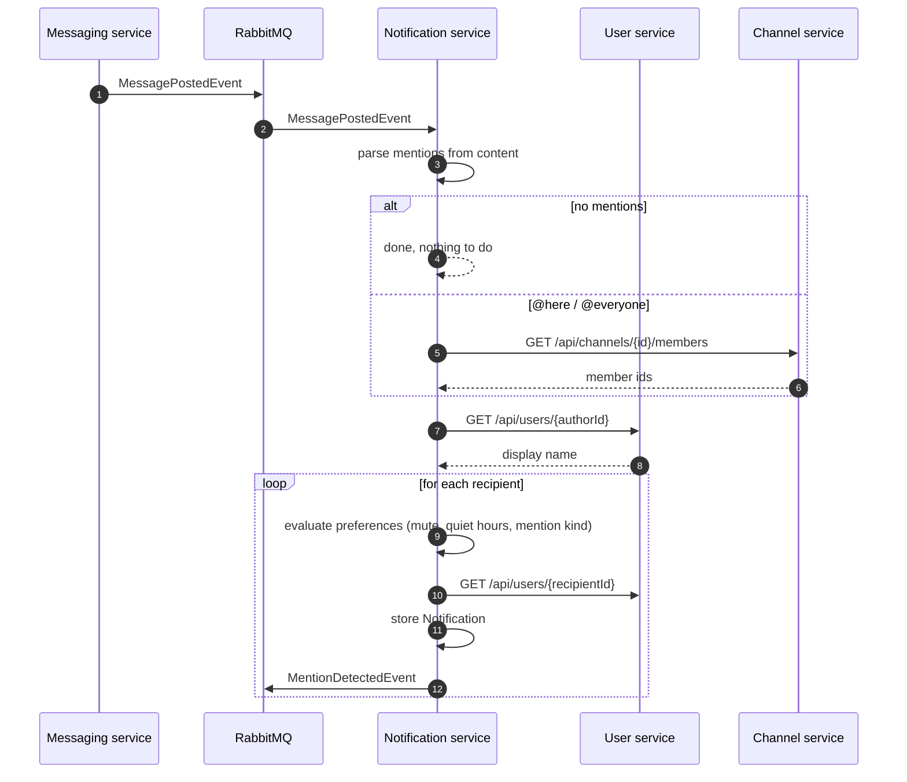
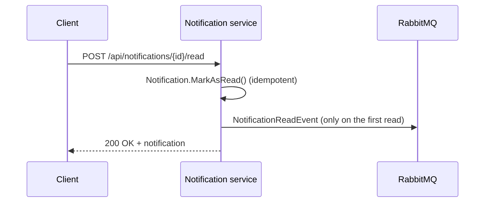
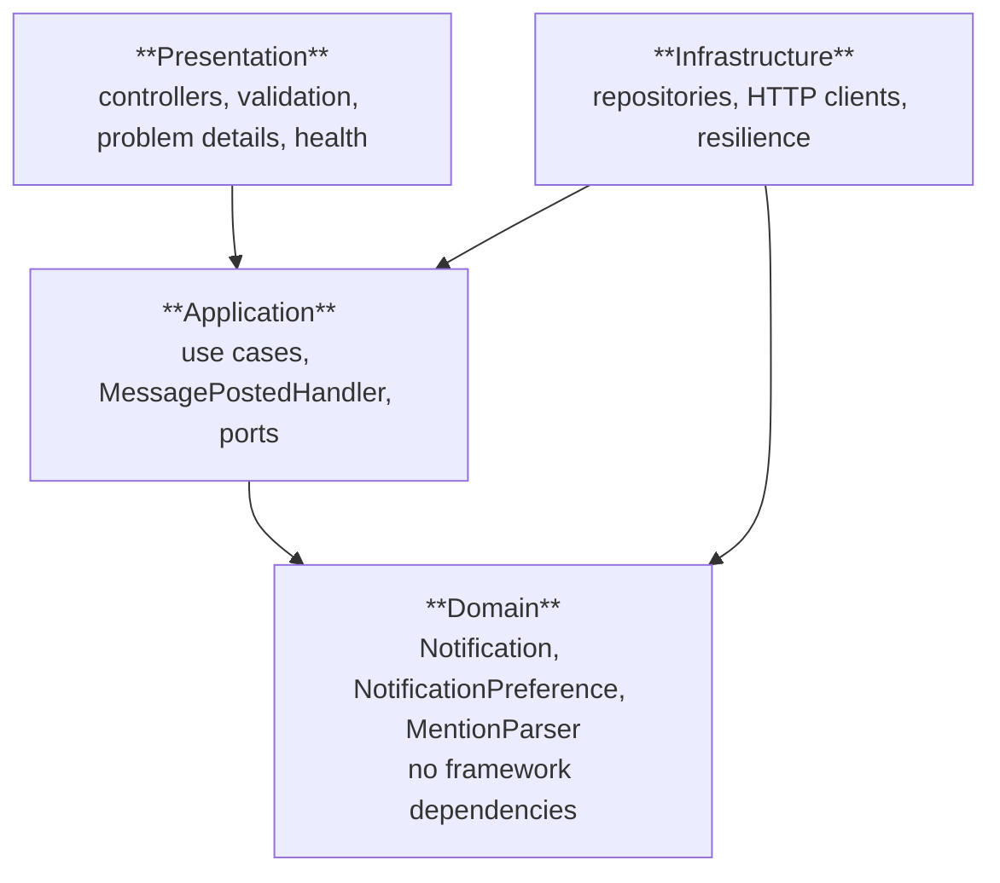

# 01 – Analysis & design

## 1. The scenario

Bizcord is a real-time enterprise communication platform: a Discord-like application where
people talk to each other in channels. This repository covers the **backend** of a single
functional domain of that platform.

A chat platform is only useful if people find out that something happened. In Discord terms:
the little red badge, the "someone mentioned you" popup, the inbox of unread items. That is
the job of a notification service, and it is why we picked this domain:

* It is the **engagement** core of the scope list ("notifications, reactions, …").
* Every other team's work flows through it: it is the main consumer of `MessagePostedEvent`.
* It is a domain with real business rules (mute, quiet hours, mention kinds), so there is an
  actual domain model to design rather than a thin wrapper around a database table.
* Practically every system in the world needs one, so the design is reusable knowledge.

## 2. Domains in Bizcord

We decomposed Bizcord by **business capability**, not by technical layer. Each domain below
is a candidate bounded context with its own model, its own data and its own team.

| Domain | Responsibility | Owns |
| --- | --- | --- |
| Identity & Users | Accounts, profiles, display names, status | users, profiles |
| Channels | Channels, membership, roles, permissions | channels, members |
| Messaging | Posting, editing and deleting messages | messages, attachments metadata |
| **Notification (this service)** | Deciding who should be told about what, and tracking whether they saw it | notifications, notification preferences |
| Presence | Who is online, typing, last active | presence state |
| Search | Indexing and querying message content | search index |
| Moderation | Banned content, reports, sanctions | moderation cases |
| Analytics | Usage metrics and reporting | aggregates |
| Media | Uploads, thumbnails, virus scanning | files |

### Why "Notification" is its own bounded context

* **Different language.** In Messaging, the central concept is a *message*. In our context it
  is a *notification*: something a specific person has not seen yet. The word "mention" means
  "markup inside text" to Messaging, and "a reason to interrupt someone" to us.
* **Different lifecycle.** A message lives forever; a notification is created, read and
  eventually archived. The states belong to the recipient, not to the message.
* **Different scaling and failure profile.** One message can create hundreds of
  notifications. Notifications are high volume, write heavy and perfectly happy to be
  eventually consistent.
* **Independent change.** Adding quiet hours or a "mentions only" switch must not require a
  change in the Messaging service.

## 3. Our boundary

### In scope

* Deciding **whether** a user should be notified about a posted message (mention detection
  plus preference evaluation).
* Storing notifications and their read state.
* Serving a user's notification inbox and unread badge count over REST.
* Managing per-user notification preferences: muted channels, quiet hours, mention kinds.
* Publishing what we concluded, so other services (push gateway, e-mail digest, analytics)
  can act on it.

### Explicitly out of scope

| Not our job | Whose job | Why |
| --- | --- | --- |
| Actually delivering push/e-mail/SMS | Push gateway / Twilio-style delivery service | Delivery is a transport concern with its own retry semantics and vendor integrations. We decide *who* and *why*; a delivery service decides *how*. |
| Message content, editing, deletion | Messaging | We only keep a short preview and a reference. |
| Who is a member of a channel | Channels | We ask; we never store membership. |
| Display names, avatars, account state | Users | We ask, and cache nothing beyond the current request. |
| Online/offline state | Presence | `@here` is expanded to channel members here; a Presence-aware refinement would be a follow-up that asks Presence instead. |

## 4. Data ownership

| Data | Owner | How we see it |
| --- | --- | --- |
| `Notification` (id, recipient, type, content, status, timestamps) | **Notification service** | Our database (see ADR-2) |
| `NotificationPreference` (mutes, quiet hours, mention switches) | **Notification service** | Our database |
| Message content | Messaging | Received in `MessagePostedEvent`, stored only as a ≤140 character preview |
| Display name, account state | Users | Read per request over REST, not stored |
| Channel membership | Channels | Read per request over REST, not stored |

The rule we follow: **no service reaches into another service's storage, and no service
stores another service's data as a second source of truth.** What we do keep is a copy of
the *conclusion* we drew (the preview text), because a notification must still be readable
when the original message is gone.

## 5. Interactions

We use both styles of communication deliberately (Newman, ch. 4–5):

| Interaction | Style | Why |
| --- | --- | --- |
| Messaging → Notification | **Asynchronous, event based** (RabbitMQ pub/sub) | Posting a message must not wait for, or fail because of, notifications. Temporal decoupling: we can be down and catch up afterwards. |
| Notification → User service | **Synchronous request/response** (REST) | We need the display name *now* to build the notification text, and the answer is small and cacheable. |
| Notification → Channel service | **Synchronous request/response** (REST) | Expanding `@everyone` needs the current member list; stale membership would notify the wrong people. |
| Notification → rest of the system | **Asynchronous, event based** | We publish what we concluded and do not care who listens. |
| Clients → Notification | **Synchronous** (REST) | A user's inbox is a query. |

### The main flow

### Reading a notification

## 6. What happens when a dependency fails

A microservice design is only honest if it says what happens when the other services are
not there (Newman, ch. 12).

| Failure | Behaviour | Rationale |
| --- | --- | --- |
| RabbitMQ unavailable at startup | The API keeps serving reads and writes; the subscription retries every 5 seconds; `/health/ready` reports degraded while `/health/live` stays healthy | A broker restart must not take the service down or trigger a restart loop |
| A handler throws | The message is not acknowledged and ends up in EasyNetQ's error queue | Nothing is silently lost; the message can be inspected and re-published |
| User service returns 404 | The recipient is skipped and logged | A notification for a user that does not exist is garbage |
| User service is down or slow | Retry (2×, 200 ms), then **fail open**: the notification is created with the generic title "Someone mentioned you" | Losing a mention is worse than losing a display name |
| Channel service is down | Channel-wide mentions produce no notifications, and it is logged as a warning | Without a member list there is nobody to notify; guessing would spam the wrong people |
| The same event is delivered twice | A duplicate notification is created today; the design for deduplication is described in [05 – Messaging](05-messaging.md#at-least-once-and-idempotency) | At-least-once delivery is the broker's contract, so this is a known, documented trade-off rather than an accident |

## 7. Architecture of the service

A classic layered architecture, with dependencies pointing inwards only:

* **Domain** has no NuGet dependencies at all. It can be unit tested without a host.
* **Application** defines the ports (`INotificationRepository`, `IUserDirectoryClient`,
  `IMessageClient`) that **Infrastructure** implements, so swapping RabbitMQ for Kafka or the
  in-memory store for PostgreSQL touches one project.
* **Presentation** translates HTTP to use cases and contains no business rules.
