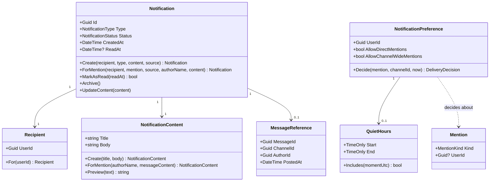
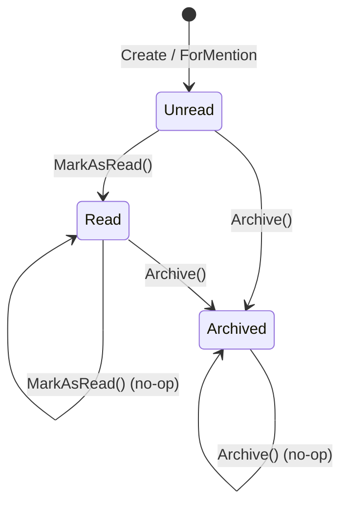

# 02 – Domain model

The model is technology agnostic: `Bizcord.NotificationService.Domain` references no NuGet
packages, so every rule below can be tested without a web server, a broker or a database.

## Overview



## Entities

### `Notification` (aggregate root)

One thing a single user should know about. It is the aggregate root: everything else in the
model exists to create one or to decide whether it should exist.

State machine:



Invariants enforced in code:

| Rule | Where |
| --- | --- |
| A notification always has a recipient | `Recipient.For` rejects `Guid.Empty` |
| A notification always has a non-empty title and body | `NotificationContent.Create` |
| A `Mention` notification must reference the message it came from | `Notification.Create` |
| A user is never notified about their own message | `Notification.ForMention` |
| A direct mention can only notify the user that was mentioned | `Notification.ForMention` |
| An archived notification cannot be read | `MarkAsRead` |
| Reading twice keeps the first timestamp (idempotent) | `MarkAsRead` returns `false` |
| Only an unread notification can have its text replaced | `UpdateContent` |

`Rehydrate` exists for the repository: loading a valid stored state must not be blocked by
creation rules (for example, a stored `Read` notification is legal, but creating one is not).

### `NotificationPreference`

How one user wants to be interrupted. This is where the business value of the service sits,
so the decision is a method on the entity rather than an `if` in a handler:

```csharp
DeliveryDecision Decide(Mention mention, Guid channelId, DateTime momentUtc)
```

The rules are evaluated in priority order:

1. The channel is muted → **suppress** ("The recipient muted this channel.")
2. We are inside the user's quiet hours → **suppress**
3. It is a direct mention and direct mentions are off → **suppress**
4. It is `@here`/`@everyone` and channel-wide mentions are off → **suppress**
5. Otherwise → **deliver**

`DeliveryDecision` carries a reason instead of a bare `false`, which makes the suppression
visible in the logs and readable in the tests.

Defaults for a user who never opened their settings: both mention kinds allowed, nothing
muted, no quiet hours.

## Value objects

| Value object | Why it is not a primitive |
| --- | --- |
| `Recipient` | A notification without a recipient is meaningless; the type makes that impossible rather than merely unlikely |
| `NotificationContent` | Owns the length limits and the preview logic, so "how a notification reads" lives in one place |
| `MessageReference` | Groups the four fields that only make sense together (message, channel, author, posted-at) |
| `Mention` | A mention is either a user or a whole channel; the type keeps `UserId` and `Kind` consistent |
| `QuietHours` | Encapsulates the surprisingly easy to get wrong "22:00–07:00 crosses midnight" comparison |

All of them are immutable `record` types with private constructors and validating factory
methods, so an invalid value object cannot exist.

## Domain services

### `MentionParser`

Turns raw message content into the mentions it contains. Bizcord uses Discord's syntax, so
renaming a user never rewrites history:

| Syntax | Meaning |
| --- | --- |
| `<@3f4c8e2a-…>` | a specific user |
| `@here` | everyone in the channel (today: all members) |
| `@everyone` | every member of the channel |

Behaviour that the tests pin down:

* Duplicate mentions of the same user collapse into one notification.
* `@everyone` wins over `@here` when both appear.
* User mentions are returned **before** channel-wide ones, which is what lets the handler
  send a single notification to someone who is both mentioned directly and covered by
  `@everyone`.
* `davud@here.com` is an e-mail address, not a mention.
* Malformed markup (`<@12345>`, `<@>`) is ignored rather than throwing.

### `MentionMarkup`

The syntax itself (compiled `[GeneratedRegex]` patterns) plus `Humanize`, which replaces
markup with display names so a notification body never shows a raw id. Unknown users become
`@someone`.

## Ports owned by the domain

```csharp
INotificationRepository            // Get, List, CountUnread, Save, Delete
INotificationPreferenceRepository  // Get, Save
```

The domain declares what it needs; `Bizcord.NotificationService.Infrastructure` decides how
it is stored. `NotificationQuery` is a small filter record (recipient, channel, status,
paging) so the repository interface does not grow a method per screen.

## Ubiquitous language

| Term | Meaning here |
| --- | --- |
| Notification | Something a specific user has not seen yet |
| Recipient | The user a notification belongs to |
| Mention | A reason to interrupt someone, found in a message |
| Channel-wide mention | `@here` or `@everyone` |
| Preference | A user's rules for being interrupted |
| Quiet hours | A daily period (UTC) where nothing is delivered |
| Suppressed | A mention that was detected but deliberately not turned into a notification |
| Preview | The ≤140 character excerpt of the message we are allowed to keep |
