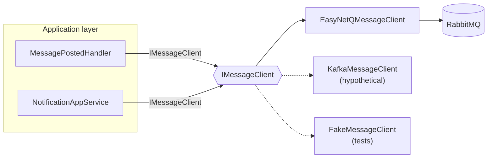
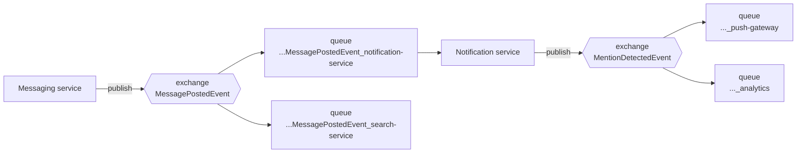

# 05 – Messaging

## The abstraction

RabbitMQ and EasyNetQ must not leak into the service. `packages/MessageClient` exposes two
interfaces, and exactly one class in the entire solution references EasyNetQ.

```csharp
public interface IMessageClient : IAsyncDisposable
{
    bool IsConnected { get; }

    Task PublishAsync<TMessage>(TMessage message, CancellationToken ct = default)
        where TMessage : class;

    Task SubscribeAsync<TMessage>(string subscriptionId,
        Func<TMessage, CancellationToken, Task> handler, CancellationToken ct = default)
        where TMessage : class;

    Task SubscribeAsync<TMessage>(string subscriptionId,
        IMessageHandler<TMessage> handler, CancellationToken ct = default)
        where TMessage : class;
}

public interface IMessageHandler<in TMessage> where TMessage : class
{
    Task Handle(TMessage message, CancellationToken cancellationToken);
}
```

Nothing in the signature mentions a broker: no exchange, no routing key, no `IBus`, no
`IModel`. Swapping to Kafka means writing `KafkaMessageClient : IMessageClient` and changing
one line of registration — the domain, the application layer and every test stay untouched.



## Registration

```csharp
// Program.cs
builder.Services.AddMessageClient(builder.Configuration, subscriptionId: "notification-service");
builder.Services.AddMessageHandler<MessagePostedEvent, MessagePostedHandler>();
```

`AddMessageClient` binds `MessageClientOptions` from the `RabbitMq` configuration section
(also accepting the plain `RABBITMQ_HOST` environment variable the assignment uses),
registers EasyNetQ with System.Text.Json, registers `IMessageClient` as a singleton and adds
the background service that starts the subscriptions.

`AddMessageHandler<TMessage, THandler>()` registers the handler as scoped and adds a
`SubscriptionStarter` for it. Each handled message gets **its own DI scope**, exactly like a
web request, so a handler can use scoped services safely.

## Topology

EasyNetQ's publish/subscribe pattern gives us one topic exchange per message type and one
durable queue per subscription id:



The subscription id is the thing that matters: it *is* the queue name.

* Same id on several instances → **competing consumers**, so the service scales horizontally
  and each message is handled once.
* Different id per service → **fan-out**, so our queue filling up never slows down Search.

Because the queue is durable, messages published while the service is down are waiting for
it when it comes back. That is the whole point of choosing events for this integration.

## Publishing

```csharp
await _messageClient.PublishAsync(new MentionDetectedEvent { ... }, cancellationToken);
```

Publisher confirms and persistent messages are enabled in the connection string, so a
`PublishAsync` that completes means the broker has accepted and written the message.

We publish:

| Event | When |
| --- | --- |
| `MentionDetectedEvent` | Once per notification created from a mention |
| `NotificationReadEvent` | The first time a notification is read |

## Consuming

`MessagePostedHandler` implements `IMessageHandler<MessagePostedEvent>` and does the
domain-specific work:

1. Parse mentions out of the content.
2. Expand `@here`/`@everyone` through the channel directory.
3. For each candidate recipient: skip the author, evaluate the recipient's preferences,
   look the user up, build a `Notification`, store it, publish `MentionDetectedEvent`.

Every published event carries `MessageId`, so one `MessagePostedEvent` can be followed all
the way to a push notification in the logs of three different services.

## Connection handling and errors

| Concern | Decision |
| --- | --- |
| The broker is down at startup | `MessageSubscriberService` retries every 5 seconds in the background. The API starts and serves traffic regardless. |
| Connection state | `EasyNetQMessageClient` listens on `IAdvancedBus.Connected`/`Disconnected` and exposes `IsConnected`, which `BrokerHealthCheck` reports on `/health/ready`. |
| A handler throws | The exception is logged and rethrown, so EasyNetQ does not acknowledge the message and moves it to its error queue. Nothing is lost silently. |
| Poison messages | They stay in the error queue for inspection and can be re-published with EasyNetQ Hosepipe rather than blocking the queue. |
| Shutdown | `DisposeAsync` disposes the subscriptions; the bus itself is owned by the DI container. |

### At-least-once and idempotency

RabbitMQ guarantees at-least-once delivery, so a redelivered `MessagePostedEvent` would
create a second notification today. This is a conscious trade-off for a student project and
not a hidden bug — the fix is a unique constraint on `(RecipientId, MessageId)` in the
repository, which the port already allows without touching the handler. Read tracking is
already idempotent: `Notification.MarkAsRead` returns `false` the second time and the
application layer only publishes `NotificationReadEvent` when the state actually changed.
