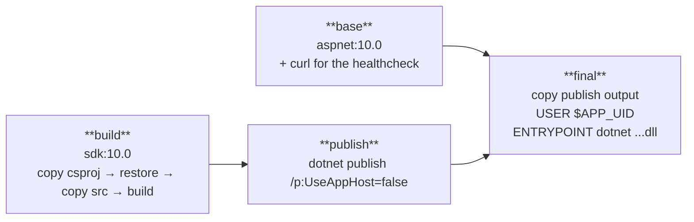
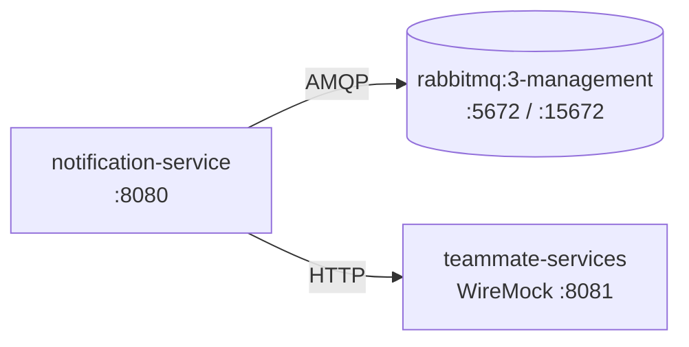

# 06 – Deployment

## Running it

```bash
docker compose up -d --build
```

| What | Where |
| --- | --- |
| Swagger UI | http://localhost:8080/swagger |
| Readiness | http://localhost:8080/health/ready |
| RabbitMQ management | http://localhost:15672 (guest / guest) |
| WireMock (stand-in for the other teams' services) | http://localhost:8081/__admin |

If a port is already taken, override it without editing the file:

```bash
RABBITMQ_UI_PORT=15673 NOTIFICATION_SERVICE_PORT=8090 docker compose up -d
```

## The Dockerfile

`apps/notification-microservice/Dockerfile` is a multi-stage build. The build context is the
**repository root**, because the service references two shared packages — a per-service
context could not see them.



Why it is written this way:

| Decision | Reason |
| --- | --- |
| The `.csproj` files are copied **before** the sources | Docker caches the `restore` layer, so changing a `.cs` file does not re-download NuGet packages |
| `Directory.Build.props` and `Directory.Packages.props` are copied too | Central package management means the projects do not contain versions, so a restore without them fails |
| The monorepo paths are preserved inside the image | `ProjectReference` paths such as `../../../packages/...` must resolve exactly as they do on a developer machine |
| `--no-restore` on build and publish | The restore already happened; repeating it wastes build time |
| `/p:UseAppHost=false` | No native launcher is needed, because the entrypoint is `dotnet <dll>` |
| Final stage is `aspnet`, not `sdk` | ~110 MB instead of ~800 MB, and no compiler in production |
| `USER $APP_UID` | The container does not run as root |
| `ASPNETCORE_HTTP_PORTS=8080` | Kestrel listens on a predictable port and does not need HTTPS certificates inside the container |
| A `HEALTHCHECK` against `/health/live` | Docker, and later an orchestrator, can see whether the process is healthy without knowing anything about the app |

## The Compose file

Three services:



```yaml
rabbitmq:
  image: rabbitmq:3-management
  healthcheck:
    test: ["CMD", "rabbitmq-diagnostics", "-q", "ping"]
    interval: 10s
    timeout: 5s
    retries: 12
    start_period: 20s

notification-service:
  build:
    context: .
    dockerfile: apps/notification-microservice/Dockerfile
  environment:
    RABBITMQ_HOST: rabbitmq
  depends_on:
    rabbitmq:
      condition: service_healthy
```

* `depends_on: condition: service_healthy` waits until RabbitMQ answers `ping`, not merely
  until the container exists. Without the health check, `depends_on` only guarantees start
  order, which is useless for a broker that needs several seconds to boot.
* `RABBITMQ_HOST: rabbitmq` works because Compose gives every service a DNS name on the
  shared network. The service never knows an IP address.
* The service is **not** dependent on the broker to start serving HTTP, so even if the health
  check were missing the service would recover by itself (see [05 – Messaging](05-messaging.md)).
  Belt and braces, on purpose.

### The WireMock container

`teammate-services` plays the role of the User service and the Channel service, which other
groups own. Stubs live in `docker/wiremock/mappings/`:

| Stub | Returns |
| --- | --- |
| `GET /api/users/{id}` | `{ id, displayName: "Demo User", isActive: true }` |
| `GET /api/channels/{id}/members` | three member ids, with the requested channel id templated back |

This makes the whole flow demonstrable before anyone else's service exists, and it is the
same tool the week-40 service tests use — so the stubs and the tests cannot disagree about
the contract.

## Configuration

Everything is configurable through environment variables, the twelve-factor way. Compose
sets them; nothing is hard coded.

| Variable | Default | Meaning |
| --- | --- | --- |
| `RABBITMQ_HOST` | `localhost` | Shorthand accepted for compatibility with the course samples |
| `RabbitMq__Host`, `RabbitMq__Port` | `localhost`, `5672` | Broker address |
| `RabbitMq__Username`, `RabbitMq__Password`, `RabbitMq__VirtualHost` | `guest`, `guest`, `/` | Credentials |
| `RabbitMq__SubscriptionId` | `notification-service` | The queue name — the one setting you must change per deployment, never per instance |
| `Services__UserDirectory__BaseUrl` | – | User service base address |
| `Services__ChannelDirectory__BaseUrl` | – | Channel service base address |
| `Services__*__Enabled` | `true` | Turns a downstream dependency off, which makes the fail-open path observable |
| `EnableSwagger` | `true` | Swagger UI, also outside Development |

## Verified behaviour

What was actually checked on the running stack, not just written down:

1. `docker compose up -d --build` → all three containers reach `healthy`.
2. `GET /health/ready` → `Healthy`, which includes a live broker connection.
3. The RabbitMQ management API shows one consumer on
   `Bizcord.Shared.Contracts.Events.MessagePostedEvent, Bizcord.Shared.Contracts_notification-service`.
4. Publishing a real `MessagePostedEvent` with the content
   `Hey <@1111...>, kan du se paa deploymentet?` created the notification
   *"Demo User mentioned you"* with the body `Hey @Demo User, ...` — so the broker, the
   handler, the WireMock user lookup, the store and the REST read all work together inside
   containers.
5. `POST /api/notifications/{id}/read` → `Read`, and the badge count dropped to `0`.
6. An invalid create request → `400` with `application/problem+json`.

## What production would need

Honesty about the gap (Newman, ch. 8):

* A real database instead of the in-memory repository, plus migrations.
* Secrets from a secret store rather than Compose environment variables.
* An image tag per commit instead of `latest`, built in CI.
* Kubernetes (or similar) with the existing `/health/live` as liveness probe and
  `/health/ready` as readiness probe, plus more than one replica — the design already allows
  it, because the subscription id is shared and the service holds no state in memory.
