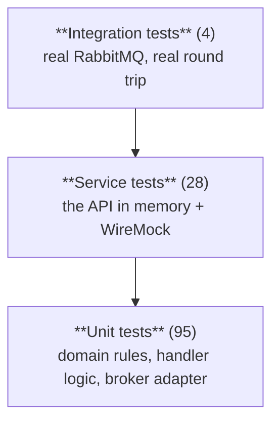

# 07 – Testing

```bash
dotnet test                      # everything
dotnet test apps/notification-microservice/tests/Bizcord.NotificationService.UnitTests
```

Current status: **95 unit tests, 28 service tests, 4 integration tests — all green.**

The integration tests need a broker and will *skip* rather than fail without one:

```bash
docker compose up -d rabbitmq
dotnet test apps/notification-microservice/tests/Bizcord.NotificationService.IntegrationTests
```

## The pyramid



Many fast tests at the bottom, few slow ones at the top (Newman, ch. 9). Tools:
**xUnit v3** as the framework, **Moq** for interaction verification, **FluentAssertions**
for readable assertions, **WireMock.Net** for stubbing other teams' services, and
`WebApplicationFactory` for hosting the API in memory.

## Unit tests — `Bizcord.NotificationService.UnitTests`

| Area | What is pinned down |
| --- | --- |
| `Domain/NotificationTests` | The state machine, idempotent reads, "never notify the author", "a direct mention only notifies the mentioned user", archived notifications cannot be read |
| `Domain/NotificationContentTests` | Title/body limits, the 140-character preview, markup replaced by display names |
| `Domain/MentionParserTests` | `<@id>`, `@here`, `@everyone`, duplicates, ordering, `davud@here.com` is not a mention, malformed markup is ignored |
| `Domain/QuietHoursTests` | Daytime and midnight-crossing ranges |
| `Domain/NotificationPreferenceTests` | The decision order: mute → quiet hours → mention kind |
| `Application/MessagePostedHandlerTests` | The handler: mention → notification, author skipped, suppressed by preferences, `@everyone` expanded through the channel directory, direct + `@everyone` deduplicated, user not found is skipped, user service down fails open |
| `Application/NotificationAppServiceTests` | CRUD use cases, validation, "read event published only once" |
| `Messaging/EasyNetQMessageClientTests` | The adapter publishes through `IBus.PubSub` and reports connection state |

### The test double the videos describe

`FakeMessageClient` (in the shared `TestSupport` project) records what was published:

```csharp
var client = new FakeMessageClient();
// ... run the handler ...
var published = client.SinglePublished<MentionDetectedEvent>();
published.MessageId.Should().Be(evt.MessageId);
```

A hand-written fake is used where we assert on *data*, and Moq where we assert on an
*interaction*:

```csharp
var client = new Mock<IMessageClient>();
client.Setup(c => c.PublishAsync(It.IsAny<MentionDetectedEvent>(), It.IsAny<CancellationToken>()))
      .Returns(Task.CompletedTask);
// ...
client.Verify(c => c.PublishAsync(It.IsAny<MentionDetectedEvent>(), It.IsAny<CancellationToken>()), Times.Once);
```

> **Why this never hits the two errors from the week-40 video.** Moq can only intercept
> members it is allowed to override, which is why mocking a concrete `MessageClient` with a
> non-virtual `Send` method fails with *"unsupported expression"*, and why a class without a
> parameterless constructor fails with *"cannot instantiate proxy class"*. We mock an
> **interface**, so there is nothing to make `virtual` and no constructor to add. The lesson
> from the video is the reason `IMessageClient` exists.

Time is injected through `TimeProvider` (`FixedTimeProvider` in tests), so quiet-hour tests
are deterministic instead of failing at 22:01.

## Consumer contract test

We consume someone else's event, so the risk is not "does my code work" but "did they change
the shape". The contract test states the minimum we need, in one place:

```csharp
[Fact]
public async Task Handler_CanConsume_MinimumValidContract()
```

It constructs a `MessagePostedEvent` with only the fields the contract promises, runs the
real handler, and asserts that a notification was created and the published
`MentionDetectedEvent` carries the original `MessageId`. If Messaging renames `Content` the
build breaks; if they start sending an empty `AuthorId`, this test breaks. Either way we find
out in CI rather than in production.

## Service tests — `Bizcord.NotificationService.ServiceTests`

The API is hosted in memory with `WebApplicationFactory<Program>`, with the broker replaced
by `FakeMessageClient` and the other teams' services replaced by **WireMock**:

```csharp
_wireMock = WireMockServer.Start();
_wireMock.Given(Request.Create().WithPath("/api/users/" + id).UsingGet())
         .RespondWith(Response.Create().WithStatusCode(200).WithBodyAsJson(new { ... }));
```

The WireMock URL is pushed into configuration, which is why `AddNotificationInfrastructure`
resolves base addresses **lazily** per client instead of reading configuration at
registration time.

| Test class | Covers |
| --- | --- |
| `NotificationsApiTests` | Every endpoint, status codes, `Location` header, paging limits, `application/problem+json` on errors, idempotent read over HTTP |
| `NotificationPreferencesApiTests` | Defaults, round-tripping a `PUT`, validation |
| `MentionFlowServiceTests` | The whole feature through the API surface: event in → notification readable over REST |
| `DirectoryClientTests` | The HTTP adapters against stubs: 200, 404, 500, timeout, and `Enabled = false` — including that a 500 becomes `Unavailable` (fail open) while a 404 becomes `NotFound` (skip) |

That last row is the point of service testing: the interesting behaviour of a distributed
system is what happens when the other side misbehaves, and WireMock is how you make the
other side misbehave on demand.

## Integration tests — `Bizcord.NotificationService.IntegrationTests`

The only tests that touch real infrastructure. They use the real `EasyNetQMessageClient`
against RabbitMQ and listen with `MessageCapture<T>`:

```csharp
await using var capture = new MessageCapture<MentionDetectedEvent>(_factory.MessageClient);
await _factory.MessageClient.PublishAsync(messagePostedEvent);
var detected = await capture.WaitForMessageAsync(TimeSpan.FromSeconds(10));
detected.MessageId.Should().Be(messagePostedEvent.MessageId);
```

| Test | Proves |
| --- | --- |
| Publish/subscribe round trip | Our abstraction really works on RabbitMQ, including serialization |
| `MessagePostedEvent` → `MentionDetectedEvent` | The full feature over a real broker, with `MessageId` preserved |
| Mark-as-read → `NotificationReadEvent` | Events published from the REST path reach the broker |
| No mention → no event | We do not spam the system |

`BrokerAvailability` probes the broker first and the tests call `Assert.SkipWhen`, so a
developer without Docker gets skipped tests instead of a red build.

## What is deliberately not tested

* The in-memory repository is an implementation detail that will be replaced; its behaviour
  is covered indirectly through the service tests.
* There is no end-to-end test across several teams' services, because we cannot deploy
  theirs. The consumer contract test and the WireMock stubs are the substitute, which is
  exactly the trade-off Newman recommends in chapter 9.
