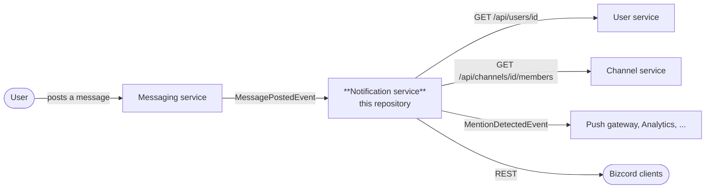

# Documentation

Analysis, design and decisions for the **Bizcord Notification Service**.

| Document | What it answers |
| --- | --- |
| [01 – Analysis & design](01-analysis-and-design.md) | Which domains exist in Bizcord, where our boundary is, who owns which data and how the services interact |
| [02 – Domain model](02-domain-model.md) | Our internal model: entities, value objects, invariants and the delivery rules |
| [03 – Shared model](03-shared-model.md) | The data contracts other teams may depend on, and what we deliberately hide |
| [04 – REST API](04-rest-api.md) | Endpoints, status codes, validation and examples |
| [05 – Messaging](05-messaging.md) | The message client abstraction, RabbitMQ topology, delivery guarantees and error handling |
| [06 – Deployment](06-deployment.md) | Dockerfile, Docker Compose, configuration and health probes |
| [07 – Testing](07-testing.md) | The test strategy: unit, service, contract and integration tests |
| [08 – Architecture decisions](08-architecture-decisions.md) | The decisions we made, the alternatives and why |
| [09 – Assignment checklist](09-assignment-checklist.md) | Where each task from weeks 36–40 is solved |

## The short version

Bizcord is a Discord-like enterprise chat platform. This repository contains **one**
microservice from that system: the service that decides who needs to know about what, and
keeps track of whether they have seen it.

